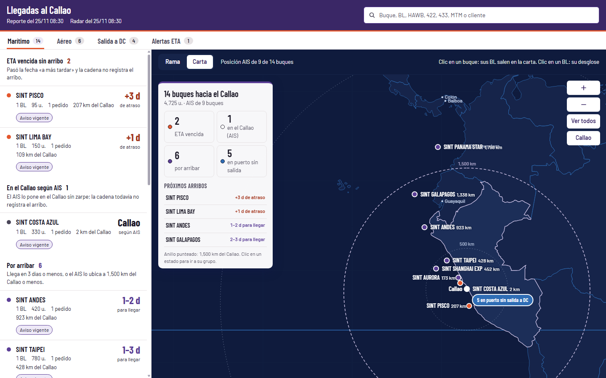
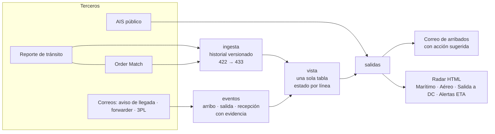
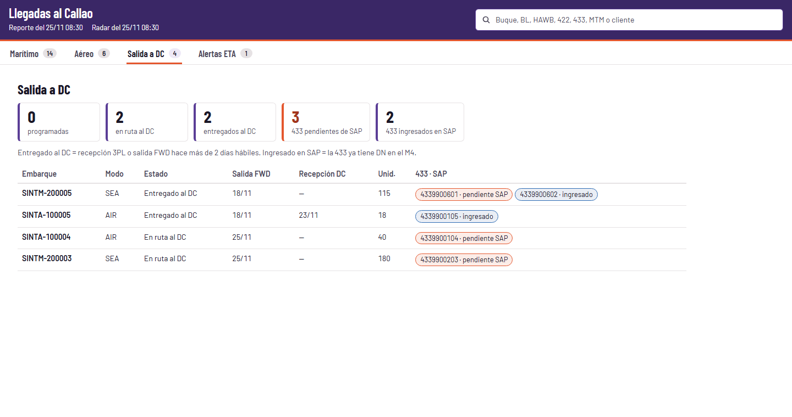
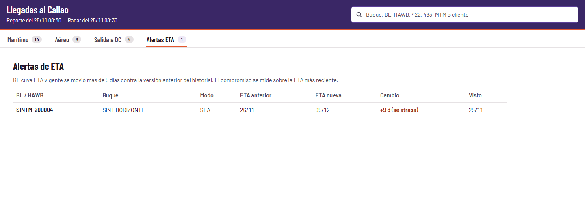
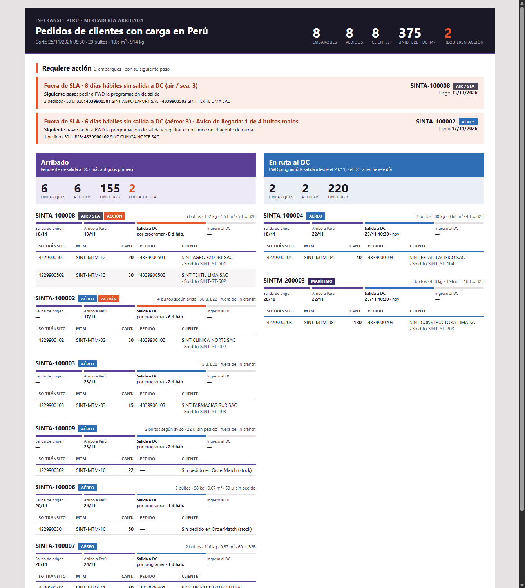
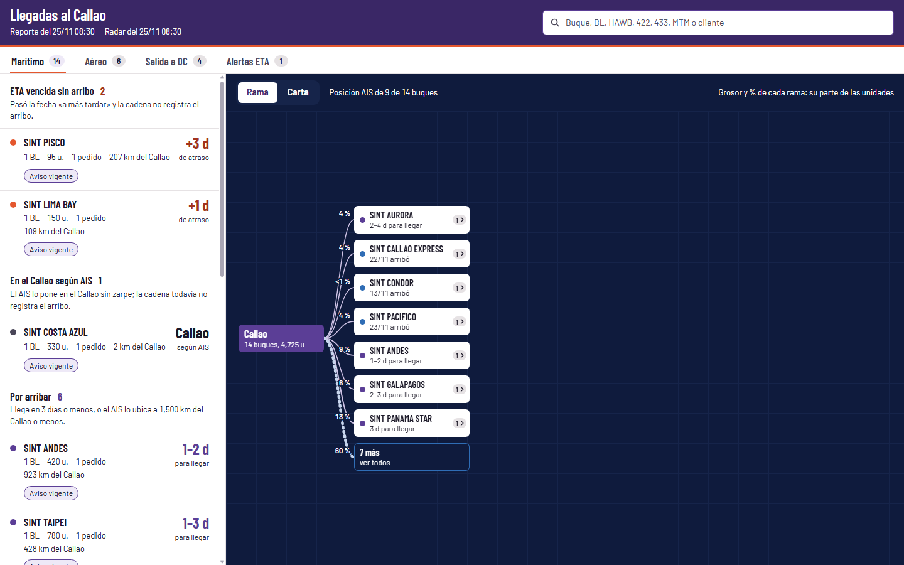

# Control Tower Inbound · trazabilidad de importaciones de punta a punta

> Cada embarque que viene a Perú, aéreo o marítimo, seguido desde el origen hasta que entra al almacén y a SAP. Se cruza el buque o vuelo → BL/HAWB → orden de tránsito (422) → pedido del cliente (433), aunque cada tramo lo informe un tercero distinto, en otro formato y a otra hora.



<sub>Todo lo que se ve es **sintético**. El proyecto real corre en un entorno corporativo; esta versión pública conserva la arquitectura, las reglas y las pruebas, sin datos ni nombres de la empresa.</sub>

---

## El problema: la carga existe, pero nadie la ve entera

La mercadería importada pasa por manos que no se hablan entre sí:

| Tramo | Quién lo informa | Cómo llega el dato |
|---|---|---|
| Origen → tránsito internacional | Reporte corporativo de tránsito | Tabla que **borra la línea** cuando la carga llega |
| Arribo (aéreo) | Agente de carga | Correo con PDF de aviso de llegada, a veces escaneado |
| Arribo y ETA (marítimo) | Forwarder | Correos libres con ETA, ATA y ATD en formatos distintos y fechas ambiguas |
| Posición del buque | Proveedores AIS públicos | Web, sin API |
| Salida al almacén | Forwarder | Correo con una tabla HTML de programación |
| Recepción en el almacén | Operador logístico (3PL) | Correo de confirmación |
| Pedido del cliente | Order Match | Tabla que **suelta el pedido** cuando la línea sale del tránsito |
| Ingreso en SAP | ERP | La DN local del pedido |

Las consecuencias eran concretas:

- **Lo que llega desaparece.** Justo cuando la carga aterriza o atraca, el reporte de tránsito borra la línea y el Order Match suelta el pedido. Un aéreo en el terminal o un buque en el puerto se volvían invisibles en el tramo más crítico: entre el arribo y el almacén.
- **Los terceros no avisan igual.** Cada uno tiene su formato, su horario y sus errores: un PDF sin texto, fechas `dd/mm` contra ISO, respuestas y reenvíos que repiten el dato.
- **Los cambios de ETA no dejaban rastro.** Un buque que se atrasaba 9 días simplemente salía del radar.
- **La operación diaria era pesada.** 9 scripts que se importaban entre sí, la misma tabla calculada 2 veces, el cruce de pedidos 4 o 5 veces por día, y una consulta pesada al data lake que casi no se usaba.

## El eje: trazabilidad y visibilidad

> **El tránsito es la espina y el pedido es visibilidad, nunca condición.**

Toda decisión del diseño sale de esa regla:

1. **Nada se pierde.** Un historial versionado guarda cada línea, con su buque y su ETA, desde la primera vez que aparece. Los historiales se escriben de forma atómica, se leen en modo estricto y nunca se reescriben solo con lo de hoy.
2. **Cada estado tiene evidencia.** «Arribado» se marca por el aviso de llegada o el ATA del forwarder, «en ruta al DC» por la programación de salida, «entregado» por la recepción del 3PL y «en SAP» por la DN. Cada fila dice de qué correo o de qué reporte sale.
3. **El tercero se valida, no se cree.** Un aviso marítimo no es arribo, porque llega cuando la carga sale de planta. Una fecha ISO no se lee día primero. Un PDF escaneado cuenta como evidencia con la fecha del correo. Las respuestas y los reenvíos no duplican.
4. **Lo que importa se ve sin buscarlo.** Hay alertas de SLA (3 días hábiles en aéreo y 7 en marítimo, sin salida al almacén), de ETA movida más de 5 días, de bultos malos o faltantes en el aviso y de 433 entregadas pero sin ingreso en SAP.

## Qué hace



| Ritmo | Comando | Qué actualiza |
|---|---|---|
| **Diario** | `python torre/torre.py diario` | Reporte, pedidos, correos, historiales, correo y radar (`--sin-lake` salta la consulta pesada) |
| **Cada hora** | `python torre/torre.py radar_horario` | Solo lo nuevo de los correos y la posición AIS. **No escribe la base:** trabaja sobre copias temporales |
| **Semanal** | `python torre/torre.py semanal` | Rescate desde el reporte semanal y una foto fija de los historiales |

## Cómo se ve

| Salida a DC: ¿llegó al almacén y está en SAP? | Alertas de ETA |
|---|---|
|  |  |

| Correo de arribados (acción primero) | Rama: buque → BL → 422 → 433 |
|---|---|
|  |  |

## Cómo se trabajó

El marco completo está en [docs/MARCO_DE_TRABAJO.md](docs/MARCO_DE_TRABAJO.md). En corto: **un paso a la vez, cada uno con su prueba, y nada se da por bueno sin evidencia.**

1. **Diagnóstico antes que código:** el mapa de qué lee y qué escribe cada script, 12 redundancias y 9 bugs con su `archivo:línea`. Lo hizo un modelo y lo auditó otro.
2. **Datos sintéticos y línea base:** 12 escenarios que reproducen cada falla real, más un Outlook, un Excel, un data lake y un AIS falsos. La cadena original se corre tal cual y se congela su salida.
3. **Refactor sin cambiar la lógica:** de 9 scripts a 5 módulos más un orquestador. Da **59 de 59 salidas idénticas**, y se comprobó con una mutación que la comparación sí detecta los cambios.
4. **Cada arreglo con su prueba:** cada una falla en la versión anterior y pasa en la nueva (7/7).
5. **Funciones nuevas con criterio de aceptación escrito antes:** arrancó en 4/13 y terminó en **13/13**.

Los problemas que aparecieron y por qué se resolvieron así: [docs/PROBLEMAS_Y_JUGADAS.md](docs/PROBLEMAS_Y_JUGADAS.md).

## Probarlo (sin Outlook, sin Excel, sin red)

```bash
pip install -r requirements.txt
python arnes/correr_demo.py           # día 1 y día 2 con datos sintéticos → salida_demo/
python arnes/aceptacion.py            # 13 criterios de aceptación
python arnes/pruebas_arreglos.py      # 7 arreglos demostrados
python arnes/prueba_radar_horario.py  # el radar horario ve lo nuevo sin tocar la base
python arnes/demo_varios.py           # radar con 14 buques sobre el mapa real → salida_demo/demo_varios.html
```

## Estructura

```
torre/        torre_config · ingesta · eventos · vista · salidas · torre (orquestador) + plantilla del radar
sinteticos/   generador determinista, fakes (Outlook, Excel COM, data lake, PDF, AIS) y ESCENARIOS.md
arnes/        demo, criterios de aceptación y pruebas
docs/         marco de trabajo, problemas y decisiones, arquitectura
assets/       capturas y mapa base (world-atlas, ISC)
```

## Stack

Python 3.11 · pandas · pyarrow · openpyxl · BeautifulSoup. HTML, CSS y JS sin dependencias para el radar (canvas propio y proyección Mercator). En producción, además: Outlook y Excel por COM (pywin32), pdfplumber y un conector AIS.

> **Sobre el AIS:** el conector real a los sitios de posición de buques **no está incluido**. Esos sitios restringen el acceso automatizado, y en producción se usa con caché, pausas al azar de 8 a 15 s, un tope de 20 consultas y un freno ante 403/429/503. Aquí el proveedor es sintético.

---

<sub>Hecho por Japura11 · supply chain + datos. Proyecto con datos sintéticos; las reglas de negocio se abstrajeron de un caso real de importaciones.</sub>
