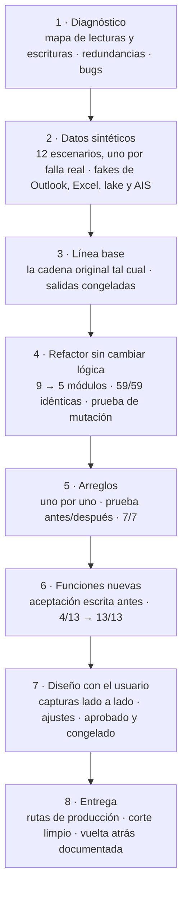

# Marco de trabajo

Cómo se pasó de una cadena que funcionaba pero no convencía a una que se puede auditar, sin romper lo que ya estaba validado.

## Principios

1. **Diagnosticar antes de tocar.** No se escribe código hasta tener el mapa de qué lee y qué escribe cada pieza, con `archivo:línea`.
2. **Las reglas validadas no se re-discuten.** Las 15 reglas de negocio acordadas con operaciones son el contrato: se mueven, no se reescriben.
3. **Un paso a la vez, cada uno con su prueba.** Se guarda lo que funcionó antes de seguir. Nada se hace «todo a la vez».
4. **Criterios antes de medir.** La aceptación se escribe primero, y al principio falla (4/13); el trabajo termina cuando pasa (13/13).
5. **Evidencia sobre opinión.** Cada estado tiene su fuente. Cada arreglo tiene una prueba que falla en la versión anterior y pasa en la nueva.
6. **Auditoría cruzada.** Lo que produce un agente o modelo lo revisa otro, verificando en el código y no en el resumen.
7. **Lo aprobado se congela.** Una vez aprobada, una vista o versión queda como copia fija y no se toca sin pedido.

## Pasos

### Por qué datos sintéticos

- **Confidencialidad:** ningún dato real sale del entorno corporativo.
- **Reproducibilidad:** el generador es determinista, con semilla y fecha fijas. La misma corrida da los mismos bytes en Python 3.10 y en 3.11.
- **Cobertura:** cada escenario existe porque reproduce un problema real: el aéreo que desaparece al llegar, el marítimo en el puerto, la ETA que salta, la doble MOT, el PDF escaneado, la línea de stock y la 433 con y sin ingreso en SAP.

### Cómo se compara

- `comparar` revisa archivo por archivo (parquets, cada hoja de Excel, HTML) contra la línea base.
- Se confirmó que la comparación detecta cambios: al alterar a propósito una cantidad, falló como debía.
- Toda diferencia contra la línea base tiene que estar explicada por un arreglo declarado. Una diferencia sin explicación es un error.

## Cómo se decide

| Situación | Criterio |
|---|---|
| Dos funciones casi iguales | Se unifican solo si son idénticas. Si la diferencia es una regla, se conservan las dos y se documenta |
| Un error de un tercero | No se corrige al tercero: se valida, se guarda la evidencia y se avisa |
| Una falla operativa (archivo bloqueado, columna nueva) | AVISO si la cadena puede seguir sin mentir; FALLO si seguiría con datos parciales |
| Un archivo nuevo en producción | Solo con OK del dueño del proceso |
| Escribir en sistemas externos (correo) | `DRY_RUN` por defecto |
| Scraping | Caché, pausas al azar, tope y freno; mejor un dato de 2 h que un bloqueo |
